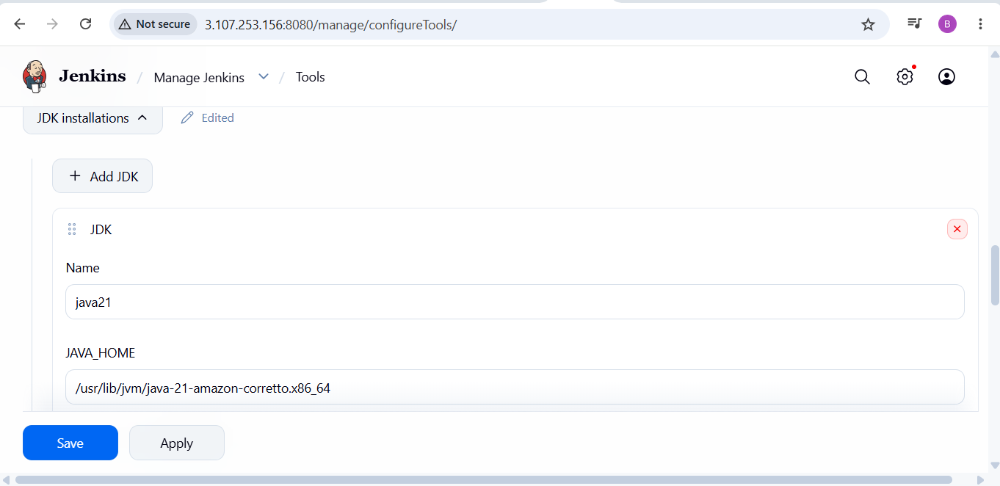

AWS, Maven, Docker, Jenkins Intergartion CI/CD.

Install Jenkins, Java, Maven: 

Create EC2 instance to host Jenkins. \
Installed Amazon Linux instance. sudo su \
yum update -y \
sudo wget -O /etc/yum.repos.d/jenkins.repo \
https://pkg.jenkins.io/redhat-stable/jenkins.repo \
rpm --import https://pkg.jenkins.io/redhat-stable/jenkins.io-2023.key \
yum upgrade \
yum install -y java-21-amazon-corretto-devel fontconfig \
yum install jenkins -y \
sudo systemctl enable jenkins       //Enable the Jenkins service to start at boot \
sudo systemctl start jenkins        //Start Jenkins as a service \
java -version \
javac -version \
systemctl status jenkins \      \\Jenkins port 8080. Open inbound port for ec2 instance. http://pub_ip:8080
yum install maven -y \
sudo alternatives --config java \
mvn -version \
sudo alternatives --config javac \
export JAVA_HOME=/usr/lib/jvm/java-21-amazon-corretto.x86_64 \
echo $JAVA_HOME \
yum install git -y 

Jenkins Portal Configuration:

In Jenkins- > Install Maven Plugins, In Tools -> Configure java and maven home directory paths. 

For code build-> Create one test build and select Maven Project and run "clean install".

