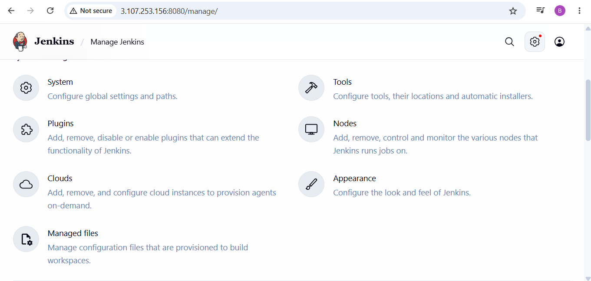
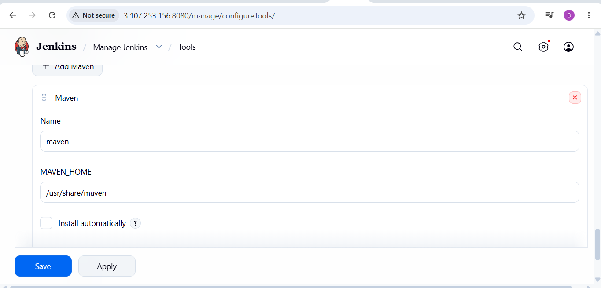
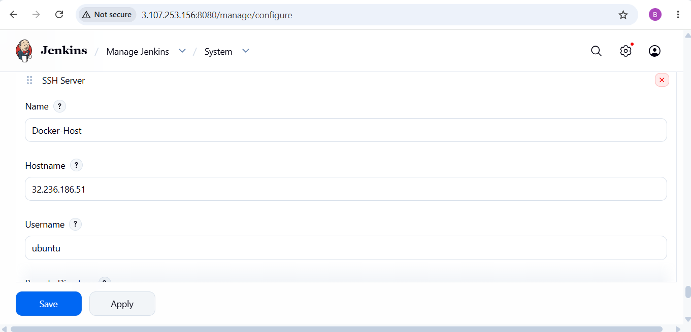
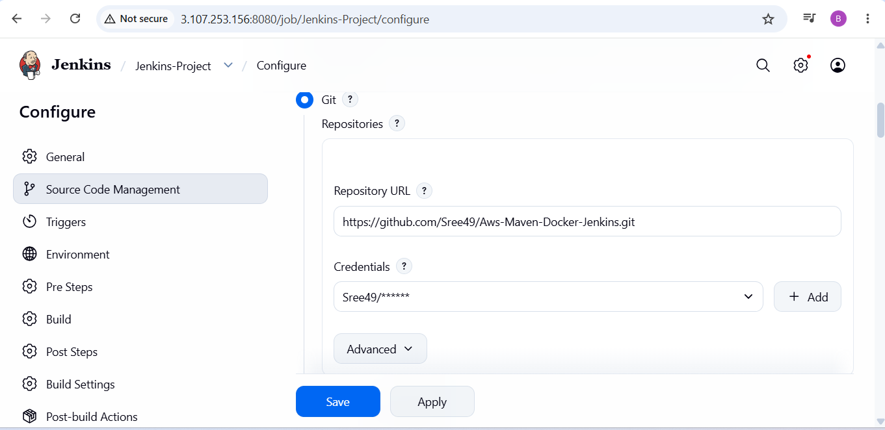
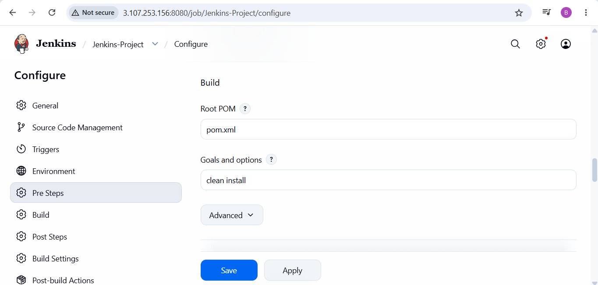
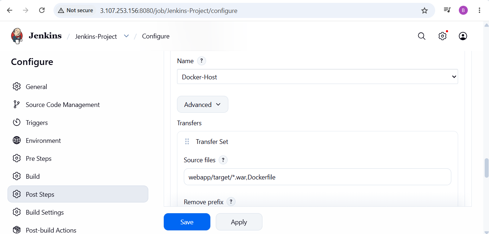
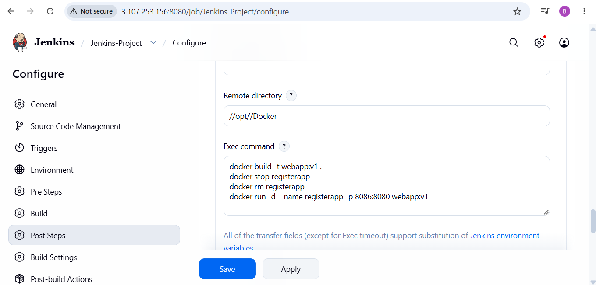
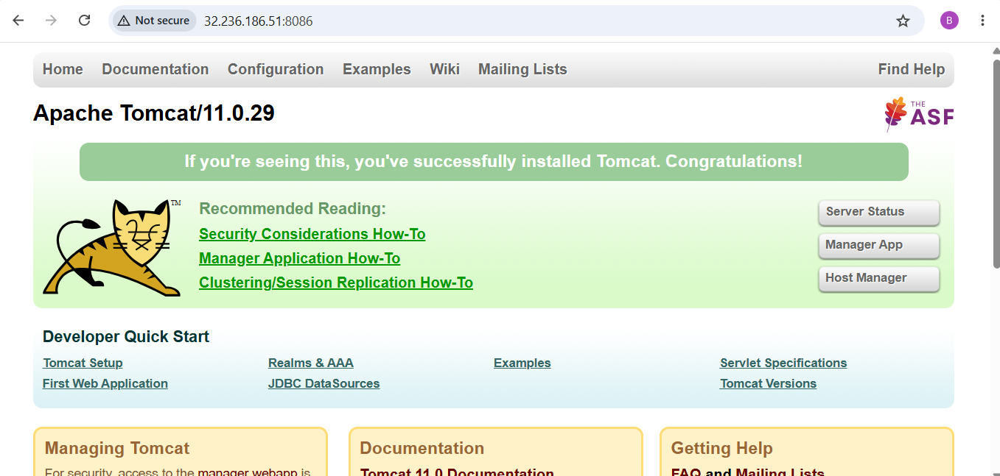
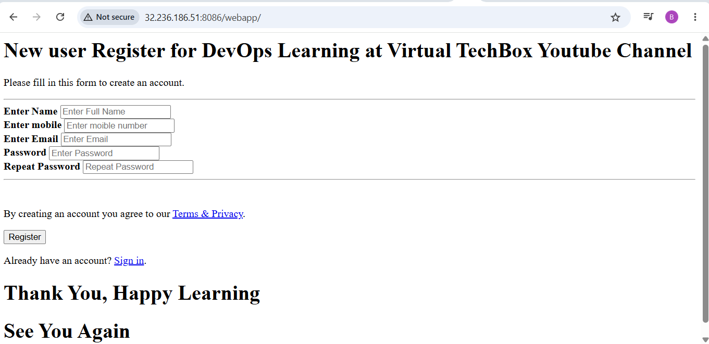

AWS, Maven, Docker (Apache Tomcat Image Build), Jenkins Intergration CI/CD.

Install Jenkins, Java, Maven: 

Create EC2 instance to host Jenkins. \
Installed Amazon Linux instance. sudo su \
yum update -y \
sudo wget -O /etc/yum.repos.d/jenkins.repo \
https://pkg.jenkins.io/redhat-stable/jenkins.repo \
rpm --import https://pkg.jenkins.io/redhat-stable/jenkins.io-2023.key \
yum upgrade \
yum install -y java-21-amazon-corretto-devel fontconfig \
yum install jenkins -y \
sudo systemctl enable jenkins       //Enable the Jenkins service to start at boot \
sudo systemctl start jenkins        //Start Jenkins as a service \
java -version \
javac -version \
systemctl status jenkins \      \\Jenkins port 8080. Open inbound port for ec2 instance. http://pub_ip:8080
yum install maven -y \
sudo alternatives --config java \
mvn -version \
sudo alternatives --config javac \
export JAVA_HOME=/usr/lib/jvm/java-21-amazon-corretto.x86_64 \
echo $JAVA_HOME \
yum install git -y 

Jenkins Portal Configuration:

In Jenkins- > Install Maven Plugins, In Tools -> Configure java and maven home directory paths. 

For code build-> Create one test build and select Maven Project and run "clean install".

Configure Docker in new Ubuntu EC2 istance: 

sudo apt update && sudo apt-get update \
sudo apt install docker.io \
sudo usermod -aG docker ubuntu \
//sudo nano /etc/hostname \
//sudo init 6 \
sudo chown -R ubuntu:ubuntu /opt \
sudo chown -R ubuntu:ubuntu /opt/Docker 

//cd /etc/ssh \            \\set password for vm
//sudo vi sshd_config \
//sudo systemctl restart sshd \
//sudo passwd ubuntu 

In Jenkins portal-> Install Publish over SSH plugin. \
Install Publish over SSH plugin and in System-> Check Publish over SSH option and give pub ip of docker host and private key -> check configuration and save.

Configure Job:

On Build webapp/target/webapp.war file is generated. 

App:

